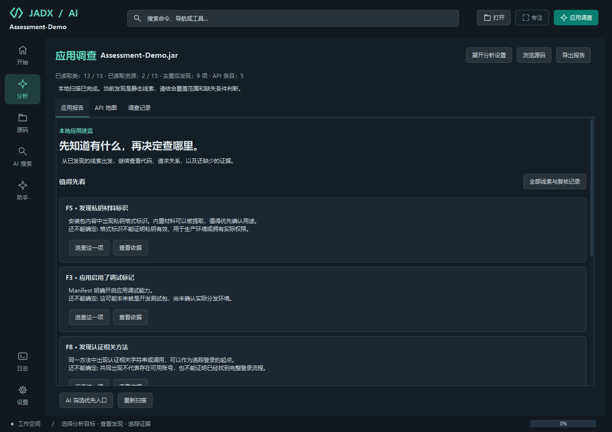
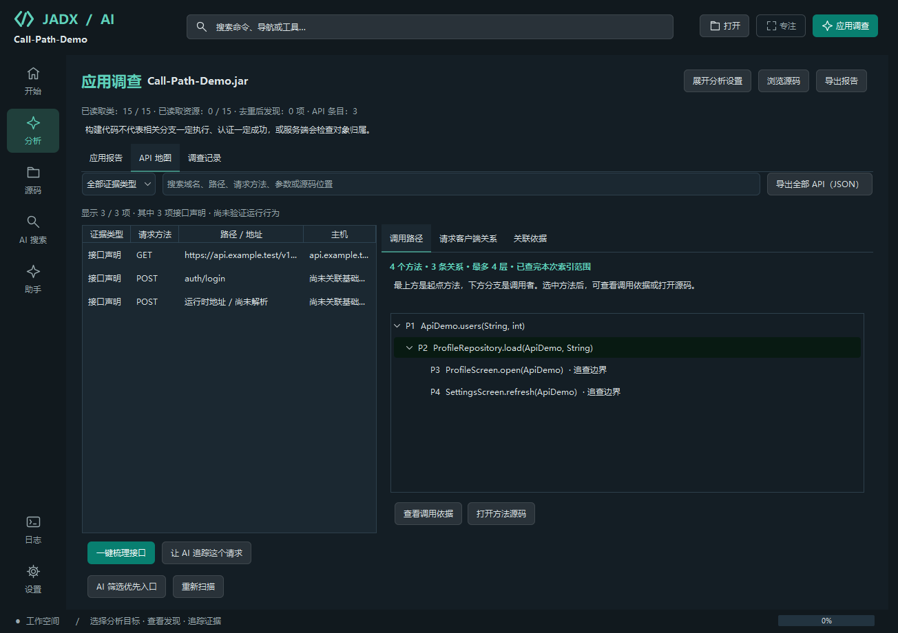
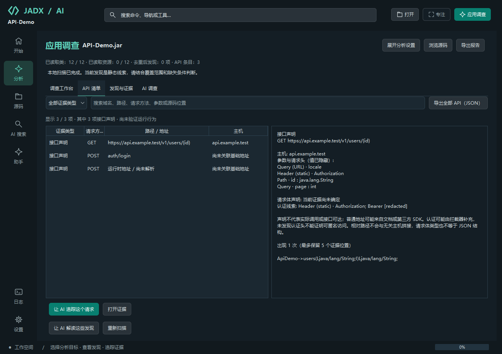
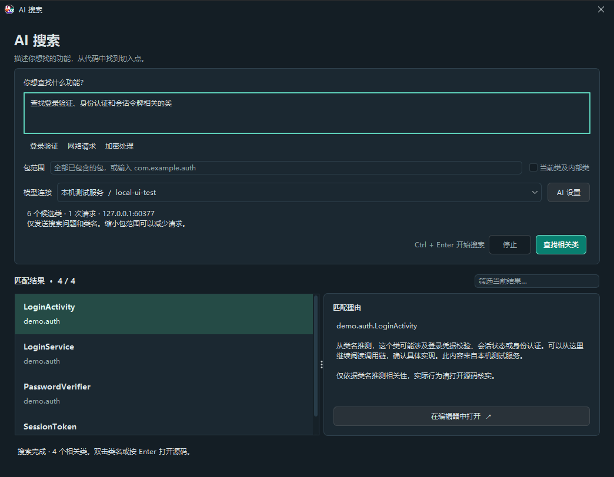
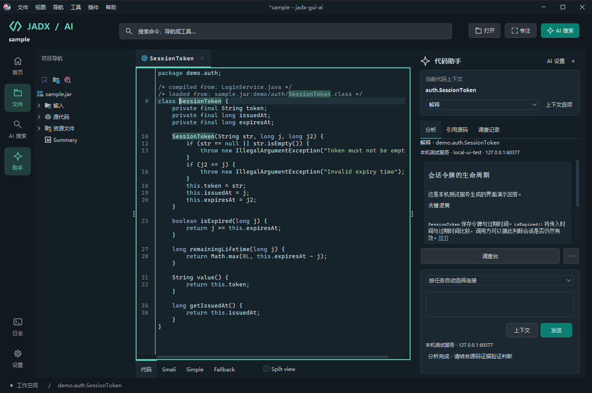

<p align="center">
  <a href="README.md">简体中文</a> · <strong>English</strong>
</p>

<h1 align="center">JADX GUI AI</h1>

<p align="center">
  <strong>Open an app. Follow the clues. Check the evidence.</strong><br>
  A desktop workspace for understanding Android apps, built on JADX.
</p>

<p align="center">
  <a href="https://github.com/cncsnet1/jadx-gui-ai/releases/latest"></a>
  <a href="LICENSE"></a>
  
  
</p>

<p align="center">
  <a href="#download-and-run"><b>Download</b></a> ·
  <a href="#explore-the-workspace"><b>Screenshots</b></a> ·
  <a href="#your-first-analysis"><b>Quick start</b></a> ·
  <a href="#documentation"><b>Documentation</b></a> ·
  <a href="https://github.com/cncsnet1/jadx-gui-ai/issues"><b>Feedback</b></a>
</p>

---

You do not need to know which class to search first. Start with a question: **What is in this app? How does login work? Which APIs and potentially sensitive constants deserve a closer look?**

**v2.0.0 is a stable release.** Opening an APK automatically creates a local application report. Move between the report, API map, and investigation history; trace API callers and supported Retrofit / OkHttp client configurations; then let a model read relevant code in bounded steps. Investigations retain their evidence and can be saved and resumed.

Local reports, API discovery, and call paths work **without a model**. The desktop packages include JADX and Java; basic analysis does not require Python, Node, or REA. AI features use a model service that you configure separately.

| Start with a report | Follow the code | Keep your evidence |
| --- | --- | --- |
| Review APIs, app entry points, authentication clues, and potentially sensitive material. | Inspect callers and client configuration, or ask AI to investigate selected leads. | Save the project, resume an investigation, or export material for further work in other tools. |

Static findings are investigation leads. They do not establish that a vulnerability exists, that an entry point is reachable, or that an attack will succeed.

## Download and run

Download the appropriate **v2.0.0** package from the [Latest Release](https://github.com/cncsnet1/jadx-gui-ai/releases/latest). Extract the complete archive before launching.

| Platform | Archive | Launch |
| --- | --- | --- |
| Windows x64 | `jadx-gui-ai-2.0.0-windows-x64.zip` | Double-click `jadx-gui-ai.exe` |
| macOS · Apple Silicon | `jadx-gui-ai-2.0.0-macos-arm64.zip` | Open `JADX GUI AI.app` |
| macOS · Intel | `jadx-gui-ai-2.0.0-macos-x64.zip` | Open `JADX GUI AI.app` |
| Linux x64 | `jadx-gui-ai-2.0.0-linux-x64.tar.gz` | Run `./bin/jadx-gui-ai` |
| Linux ARM64 | `jadx-gui-ai-2.0.0-linux-arm64.tar.gz` | Run `./bin/jadx-gui-ai` |
| Portable · bring your own Java | `jadx-gui-ai-2.0.0-portable.zip` | Run `bin/jadx-gui-ai` or `bin\jadx-gui-ai.bat` |

The five platform packages bundle **Eclipse Temurin 21**. The portable package requires a 64-bit Java 17+ installation; Java 21 is recommended. Linux requires a graphical desktop and a glibc-based distribution. The Windows executable and macOS app are unsigned; the macOS app is also not notarized. Follow the operating system's prompts when opening it for the first time.

The Windows package has been tested by launching the application. macOS and Linux archives have been checked for contents, runtime architecture, permissions, and launchers, but have not yet completed native testing on those systems.

The original JADX CLI is included as `bin/jadx`, or `bin\jadx.bat` on Windows. Release assets include `SHA256SUMS.txt` and `release-manifest.json` to check the downloads, source commit, and bundled runtime.

## Your first analysis

1. **Open a file.** Drop an APK, DEX, JAR, or CLASS onto the start page. After loading, the app opens the analysis workspace and generates a local report.
2. **Read the report.** Explore APIs, entry points, potentially sensitive constants, configuration clues, source locations, and gaps in coverage. No model connection is needed.
3. **Trace an API.** Select an API declaration or request-construction entry point in the API map. Inspect callers, client configuration, interceptors, and unresolved relationships.
4. **Ask AI to continue.** Configure a Chat Completions-compatible connection, then choose a goal or lead. The investigation reads related code within a fixed budget and keeps its steps and evidence. You can stop and resume it.
5. **Save or export.** Save a `.jadx` project, or export the report, API inventory, and investigation material. Record manual verification separately when you are ready to assess a finding.

Opening a file and restoring a report do not invoke a model. The source navigation remains available for browsing the file tree and editor at any time.

### Connect a model

Save a cloud service, local service, or compatible gateway as a connection in the AI connection center.

| Field | What to enter |
| --- | --- |
| Connection name | A descriptive name, such as `Local · Code explanation` or `Cloud · Review` |
| API address | The service's base URL, such as `https://your-gateway.example/v1`, or its full `/chat/completions` endpoint |
| Model | Fetch the service's model list, or enter a model ID supported by that service |
| Authentication | Enter an API key or store the name of an environment variable; leave it empty for local services that do not require authentication |
| Task assignment | Optionally assign different connections to explanation, tracing, review, naming, and AI search; unassigned tasks use the default connection |

Fetching models requires a `/models` endpoint. You can still enter a model ID manually if that endpoint is unavailable. Services with other native protocols need a compatible gateway. Environment variables are read by the application process, so restart the app after changing them.

You can test streaming responses and switch connections for a task. A failed request displays an error; it does not automatically forward your code to another service.

## Explore the workspace

The screenshots below come from actual Swing components using compiled demonstration inputs. AI interactions use a local mock service to exercise the workflow; they do not demonstrate the accuracy of a real model. Screenshots currently show Chinese interface labels.

### A report comes first

The local report highlights useful leads and missing evidence. Three primary views connect the application report, API map, and investigation history. AI investigations retain source evidence, steps, open questions, stop reasons, and the last complete answer.



[Light theme](docs/images/application-report-light.png) · [Investigation history](docs/images/investigation-history-graphite.png). These screenshots show the v2.0.0 workflow.

### Follow an API to its callers

Select a declaration or request-construction entry point to trace up to four levels of callers. Each edge is checked against an exact bytecode call target. Inspect the call evidence or jump to source; unresolved boundaries remain visible.

Client analysis handles supported straight-line Retrofit / OkHttp construction patterns, keeping multiple clients' base URLs and interceptors separate. Dynamic configuration, helper methods, dependency injection, and branches may remain unresolved.



[Light theme](docs/images/api-call-path-light.png). This view uses an offline demo and does not require a model or external analysis engine. A static relationship does not prove execution or exploitability.

### Organize APIs and choose where to look next

The API inventory separates **interface declarations, address clues, and request-construction entry points**. Search hosts, paths, HTTP methods, parameters, and source locations. Retrofit extraction covers Path / Query / Header / Body, form fields, and upload fields; OkHttp and HttpURLConnection provide construction entry points to investigate further.

Relative paths without a resolved base URL stay marked as unresolved. An absent authentication header is not treated as proof of anonymous access. Inventories support source navigation, further AI investigation, project persistence, and redacted JSON / Markdown exports.

AI can also organize the evidence it has read into candidate starting points, explaining prerequisites, existing protections, investigation cost, missing evidence, and next steps. These rankings are model inferences, not attack success rates. General investigation guides suggest a search order; they are distinct from the bytecode-backed API call paths above.



[Investigation routes](docs/images/exploration-graphite.png) · [Candidate starting points](docs/images/opportunity-graphite.png). These views are retained from earlier releases.

### Search in natural language, then inspect the code

AI search uses class-name semantics to help find starting points. Choose a package scope and model connection, follow batch progress, review match explanations, filter results locally, and jump to source. You can inspect the sending scope and cancel the search. Matching a class name is a clue; behavior still needs source review.



The source assistant follows the current method or selection. Ask follow-up questions, navigate numbered references, and preview comment or rename suggestions before applying them. The context preview shows the exact source snapshot, related callers, truncation markers, and recent conversation that will be sent.



The original investigation view separates source observations, hypotheses, and open questions. Citation checking highlights matching text in the saved snapshot; your review status and notes are stored independently. A matching quotation confirms that the text exists, not that the model's conclusion is correct.

Both **Jadx Graphite** and **Jadx Light** themes are available in appearance preferences. The command palette opens with `Ctrl / ⌘ + K`; focus mode temporarily hides side panels and restores them when toggled again. These screenshots show tools retained from earlier releases.

## MCP in both directions

Open the **MCP connection center** from the Tools menu to use either mode:

- **Share the current project:** external AI clients can use the local read-only tools to inspect classes, source, references, and call relationships. `trace_calls` and `inspect_api` expose the same bounded analysis used by the desktop workspace.
- **Connect external tools:** the built-in assistant can connect to stdio or HTTP MCP servers. Each tool invocation requires confirmation. Large tool catalogs and results support discovery and session-local paging.

The `rea-static` filter helps select relevant tools when connecting a separately supplied REA service. This app does not install or automatically start REA, and native REA engine integration is not part of v2.0.0. See the [MCP guide (Chinese)](docs/MCP.md) for setup and supported tools.

## Capabilities and limits

| Area | Current behavior |
| --- | --- |
| Local discovery | Bytecode and resource scanning with deduplication, classification, source locations, and coverage limits |
| API call paths | Up to 4 caller levels, 48 methods, and 96 relationships; evidence and unresolved boundaries remain visible |
| AI investigations | Up to 3 starting leads, 6 planning rounds, and 12 local reads per run; supports cancellation, saving, and continuation |
| Saved investigations | Up to 24 investigations per project and 96 evidence entries per investigation; restoration checks input identity and engine configuration |
| Source context | Current method, selection, or class; up to 12,000 characters of primary source plus up to 3 callers at 3,000 characters each; truncation is visible |
| Connections | Separate services and models, per-task assignments, environment-variable keys, and response diagnostics |
| Source assistant review | Up to 8 structured leads per analysis; citation text checks, independent review notes, and up to 100 saved records |
| Suggested edits | Opens the native comment or rename dialog for review; changed source requires a fresh analysis |
| Reports | Export formats depend on the view: application reports, API JSON / Markdown, and source-assistant Markdown / HTML with model attribution, snapshots, answers, and review notes |
| JADX features | Decompilation, resource browsing, full-text search, find usages, deobfuscation, and existing debugging tools |
| Optional Java preprocessing | With a separately configured local Java Deobfuscator, detect and try ZKM / Allatori / Stringer rules, inspect the processing report, and fall back to the original input on failure |

Java preprocessing is optional and is not a guarantee that an arbitrary obfuscated APK can be recovered. See [configuration and coverage (Chinese)](docs/JAVA_DEOBFUSCATION.md).

If a model does not return usable structured leads, its complete answer is still retained as text. Analysis uses bounded static evidence rather than complete APK data-flow reconstruction. Reflection, native code, dynamic dispatch, runtime values, and server-side behavior may need additional evidence. The app does not automatically execute the APK, call target APIs, validate discovered credentials, or prove a vulnerability.

### Code, credentials, and saved material

Project content is sent to your selected model only when you initiate an AI action. The content depends on the action: AI search sends class-name batches, while code analysis uses selected source, related callers, and recent conversation from the same context. Model-list requests and connection tests do not send project source. Changing the connection, account, model, or source context prevents the old conversation from being carried into the new analysis automatically.

Connection settings are stored locally. An API key entered directly is stored as plain text; using an environment variable stores only its name. Investigation records are saved with the `.jadx` project, and reports can contain source snapshots. Review the contents before sharing them. See the [workbench guide (Chinese)](docs/AI_WORKBENCH.md) for details.

## Build from source

Use JDK 17 or newer. The release workflow uses JDK 21, and the repository includes the Gradle Wrapper.

```bash
# macOS / Linux
./gradlew :jadx-gui:test :jadx-gui:installShadowDist
./jadx-gui/build/install/jadx-gui-shadow/bin/jadx-gui
```

```powershell
# Windows PowerShell
.\gradlew.bat :jadx-gui:test :jadx-gui:installShadowDist
.\jadx-gui\build\install\jadx-gui-shadow\bin\jadx-gui.bat
```

Multi-platform packaging, runtime locks, checksums, and the GitHub release workflow are documented in the [release guide (Chinese)](docs/RELEASING.md).

## Documentation

This README and the [Chinese README](README.md) cover installation, configuration, workflows, and current limits. The detailed guides below are currently in Chinese.

| Guide | Contents |
| --- | --- |
| [AI workbench](docs/AI_WORKBENCH.md) | Connections, search, context, investigation, and reports |
| [Application investigation](docs/ASSESSMENT_WORKFLOW.md) | Local discovery, investigation routes, and manual review |
| [API inventory and call paths](docs/API_INVENTORY.md) | Extraction coverage, client relationships, and evidence |
| [MCP](docs/MCP.md) | Project sharing and external tool connections |
| [Java deobfuscation](docs/JAVA_DEOBFUSCATION.md) | Optional preprocessing and fallback behavior |
| [Upstream and REA design](docs/UPSTREAM_REA_DESIGN.md) | Implemented scope, borrowed ideas, and remaining work |
| [v2.0.0 release notes](docs/releases/v2.0.0.md) | Changes, validation, and platform coverage |
| [Release guide](docs/RELEASING.md) | Packaging and publishing |

## Next steps and contributions

Future work includes organizing goals across separate analyses, tracking changes in evidence and conclusions, comparing multiple models on the same snapshot, and connecting static clues to previewable runtime observations. These are planned improvements, not current guarantees.

Use [Issues](https://github.com/cncsnet1/jadx-gui-ai/issues) to share a concrete scenario, reproduction steps, or interface feedback. Read the [contribution guide](CONTRIBUTING.md) before contributing code. When changing installation instructions, feature coverage, or limits, update both README languages together.

## Credits and license

Built on [skylot/jadx](https://github.com/skylot/jadx), with thanks to the JADX maintainers and the maintainers of its dependencies. The desktop interface uses FlatLaf and RSyntaxTextArea. Bundled Java runtimes come from [Eclipse Temurin](https://adoptium.net/).

The project uses the [Apache License 2.0](LICENSE). See [NOTICE](NOTICE) for third-party notices; runtime vendor licenses are preserved in the release packages. The AI extensions are maintained by 云麾安全实验室 (Yunhui Security Lab).
