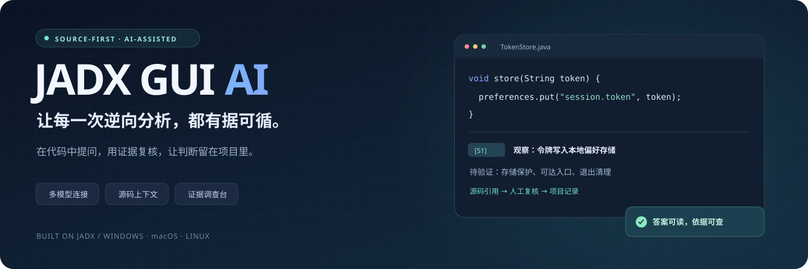
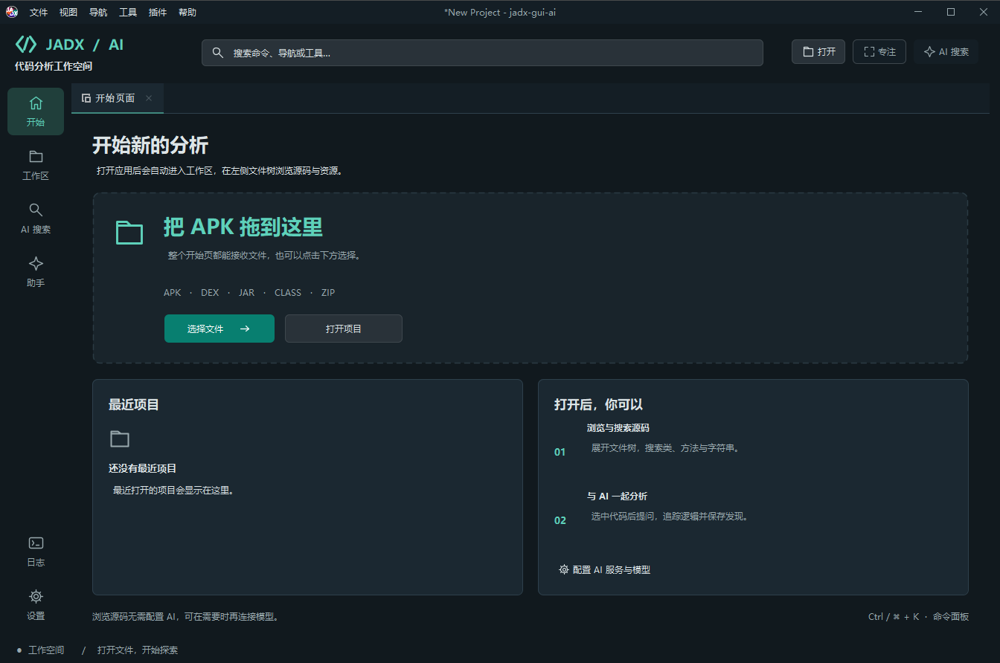
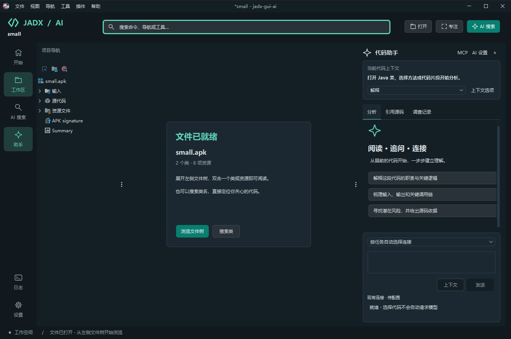
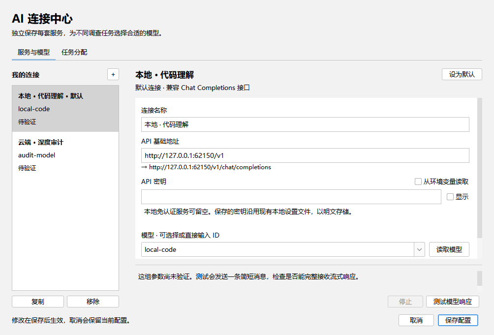
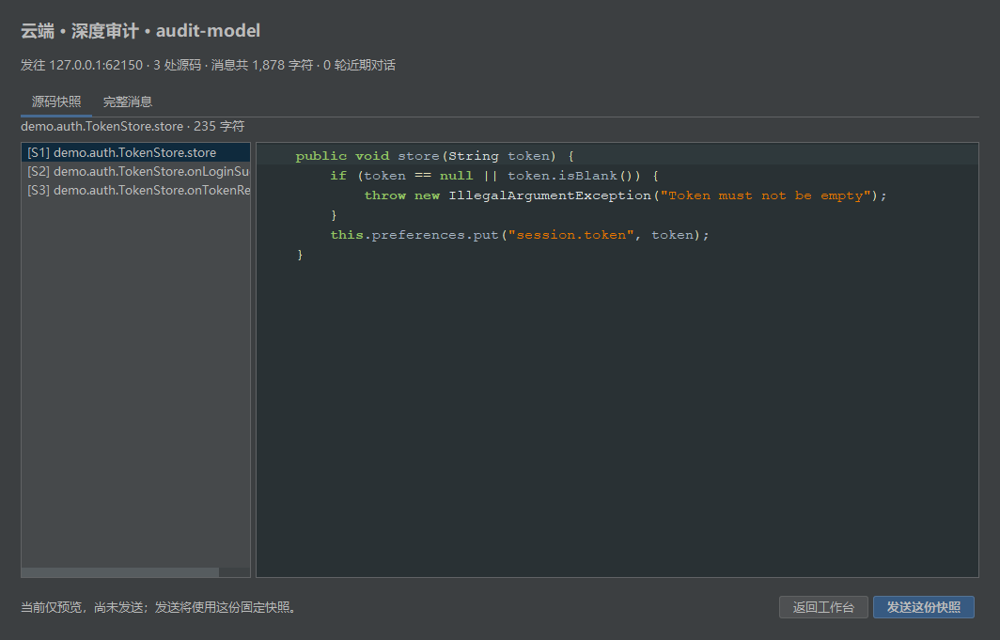
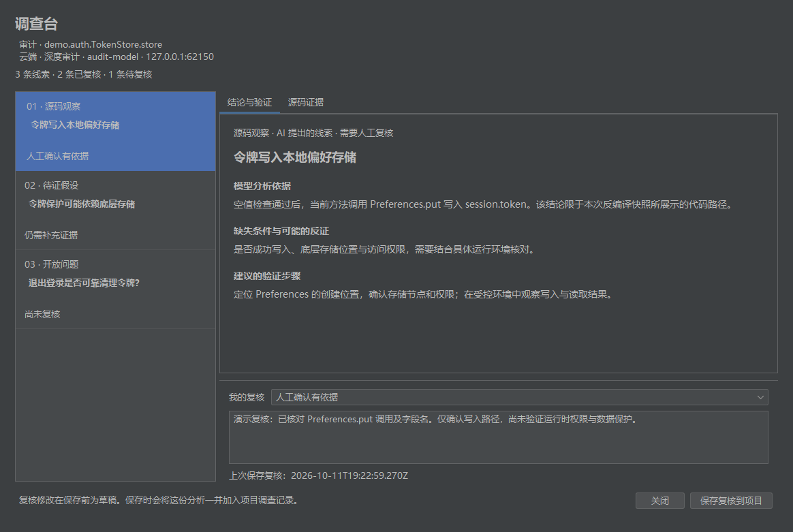
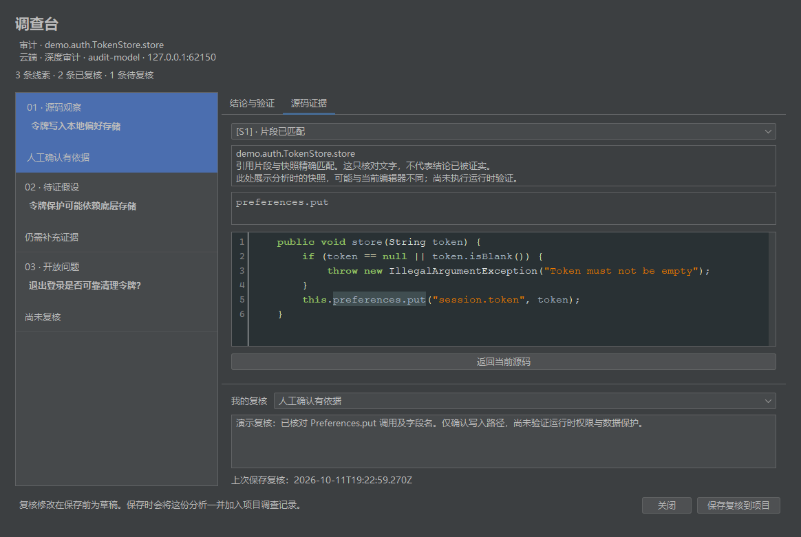

<p align="center">
  <strong>简体中文</strong> · <a href="README.en.md">English</a>
</p>

<p align="center">
  
</p>

<p align="center">
  <strong>打开应用，告诉 AI 你想了解什么，让每条结论都有据可查。</strong><br>
  Goal-driven app analysis, with evidence you can inspect.
</p>

<p align="center">
  <a href="https://github.com/cncsnet1/jadx-gui-ai/releases"></a>
  <a href="LICENSE"></a>
  
  
</p>

<p align="center">
  <a href="#下载与启动"><b>下载与启动</b></a> ·
  <a href="#看见完整工作流"><b>界面预览</b></a> ·
  <a href="#三分钟开始第一次分析"><b>快速上手</b></a> ·
  <a href="docs/AI_WORKBENCH.md"><b>使用手册</b></a> ·
  <a href="https://github.com/cncsnet1/jadx-gui-ai/issues"><b>反馈建议</b></a>
</p>

---

不懂逆向、不知道该搜哪个类，也可以先从“这个应用里有什么”“登录怎么实现”“有哪些接口和敏感信息线索”开始。

> **v2.0.0 正式版：** 打开 APK 自动生成本地应用报告；「应用报告 / API 地图 / 调查记录」三页导航；一键梳理 API 调用路径与 Retrofit / OkHttp 客户端；有预算、可保存和继续的 AI 调查；MCP 调用关系工具、REA 工具筛选和长结果分页。无需模型即可扫描与查看请求关系。见[本轮实现范围与后续设计](docs/UPSTREAM_REA_DESIGN.md)。

> **主分支开发进展（尚未包含在 v2.0.0 下载包）：** API 地图新增 Burp「实际流量」。在 Burp 安装并启用官方 MCP Server 后，点击「连接 Burp」即可使用默认本机地址，成功后自动记住配置；无需导出代理 JAR、选择 Java 或填写启动参数。支持按主机读取历史、源码候选关联、证据摘要保存和转交 Repeater。目前通过协议样本和 Windows 界面回归，完整 Burp 实机联调待完成。见 [Burp 联动说明](docs/BURP_WORKFLOW.md)。

**面向初学者的应用调查工作区**：先梳理 API、入口和有用材料，再由 AI 读取相关代码、比较值得先尝试的入口，解释已有依据与待追踪环节。可以导出线索包，到其他工具继续调查；需要评估问题时再记录人工核查。未连接模型也能使用本地发现、API 清单与路线指南。原有源码助手、AI 搜索、人工复核与 MCP 继续保留。

> 下载 **v2.0.0** 即可使用这套流程。本地发现无需配置模型；AI 深入调查使用你配置的连接。分析基于有限静态证据，不代表已确认漏洞或攻击成功率。

<table>
  <tr>
    <td width="33%" valign="top"><b>01 / 找到起点</b><br><br>默认寻找渗透路径，整理 API、应用入口、身份流程和有用材料。</td>
    <td width="33%" valign="top"><b>02 / 自动追查</b><br><br>AI 选择已有线索，读取关联方法与调用者，解释依据和未知条件。</td>
    <td width="33%" valign="top"><b>03 / 继续调查</b><br><br>导出线索包带到下一工具，或切换核查视图记录验证结果。</td>
  </tr>
</table>

## 看见完整工作流

### 报告先行，可继续调查

APK 加载后自动生成本地报告，先解释值得看的线索与未知条件。三个主页面连接应用报告、API 地图与调查记录；查询调用路径和客户端关系无需模型，AI 深入调查则保留步骤和证据，支持取消后继续。


[浅色主题](docs/images/application-report-light.png) · [调查历史与回答](docs/images/investigation-history-graphite.png)。这些快照来自实际 Swing 界面，使用演示样本和本机模拟模型；对应 v2.0.0。下文同时展示保留的调查、核查与源码工具，部分截图来自早期版本。

### 从接口追到业务调用者

在 API 地图选择接口声明或请求构造入口，点击「一键梳理接口」，查看最多四层的业务调用路径、客户端配置与拦截器。路径节点支持调用依据和源码跳转，无法继续追查的地方会标明原因。静态关系不等于已执行或可利用。


[浅色主题](docs/images/api-call-path-light.png)。界面来自离线编译的演示样本，无需模型或额外分析引擎。调用路径基于有界静态证据。

### 从调查路径开始

加载后自动生成应用报告，展示敏感材料、API 声明、观察到的主机和入口线索；在“全部线索”中可按调查方向浏览起点。选中一条，即可查看建议追踪顺序、已有证据、未知条件与下一阶段材料。可以只找方向，无需先评级或提交漏洞结论。


[查看浅色主题](docs/images/exploration-light.png)。以上为应用实际 Swing 组件的渲染快照，使用演示代码与本机模拟模型连接。路线指南表示搜索顺序，尚不是已还原的调用链或可利用攻击链；“做核查”保留独立的人工验证记录。完整流程见[应用调查说明](docs/ASSESSMENT_WORKFLOW.md)。

### 先从哪里入手

点击 **“AI 筛选优先入口”**，把已读线索整理成“优先尝试 / 先补证据 / 条件较多”卡片。每张卡说明进入条件、验证成本、已有防护、可能影响、排序理由和下一步，并能跳回引用源码。纯地址、抽象声明、未知条件或截断代码不会被直接推荐为优先尝试；排序是 AI 对本轮证据的推断，不代表攻击成功率。


[浅色主题](docs/images/opportunity-light.png)。上述演示使用本机模拟模型验证交互，真实推理质量取决于连接的模型和提供的代码范围。

### 自动梳理 API

“API 清单”把 **接口声明、地址线索、请求构造入口** 分开呈现，可搜索域名、路径、请求方法、参数和源码位置。Retrofit 声明可提取 Path / Query / Header / Body、表单与上传字段；OkHttp 和 HttpURLConnection 提供待追踪的构造入口。支持源码跳转、AI 继续追踪、随项目保存及脱敏 JSON / Markdown 导出。

相对路径尚未关联基础地址时会明确标记；未发现认证头也不会判定为匿名接口。完整覆盖范围及后续安全检查设计见 [API 清单说明](docs/API_INVENTORY.md)。


[查看浅色界面](docs/images/api-inventory-light.png)。截图由实际应用渲染，数据来自专门编译的演示接口；AI 交互使用本机模拟服务。

### 一个重新组织的分析空间

左侧导航连接开始页、工作区和代码助手；顶部 `Ctrl / ⌘ + K` 命令面板可以快速找到菜单功能。专注模式临时收起两侧面板，再次点击即可恢复布局。开始页、编辑器和 AI 侧栏使用统一的石墨灰与青绿色风格，同时提供浅色主题。

“开始”页支持整页拖入文件。加载成功后默认进入 **应用调查** 并自动生成本地报告；左侧 **源码** 随时进入文件树和编辑器。打开文件和恢复报告均不会调用模型；选择调查目标后才请求 AI 深入分析。以下旧版截图展示 beta.3 的文件入口；新流程说明见[使用手册](docs/AI_WORKBENCH.md#面向目标的自动分析)。





### 用自然语言找到代码入口

新版 AI 搜索提供包范围、模型连接、批次进度、匹配理由与源码跳转。搜索前即可看到发送范围，支持取消与本地结果筛选。类名匹配用于发现线索，实际行为仍需核对源码。


界面提供 **Jadx Graphite / Jadx Light** 两套主题。已有用户可在“首选项 → 外观”中切换，详见[使用手册](docs/AI_WORKBENCH.md)。上图为应用自身渲染的组件快照，数据来自演示代码与本机测试服务。

### 代码在左，问题和线索在右

源码工作台跟随当前方法或选区。选择任务后即可分析，也可以继续追问；引用编号支持跳转，注释与命名建议先预览再应用。


> 以下界面均来自实际程序，使用演示代码与本地模拟服务；展示的是交互流程，不代表某个模型的真实推理效果。首屏头图为功能示意。

### 多套模型连接，一次配置，各司其职

将常用云端、本地服务或兼容网关保存为独立连接。可以读取模型列表、测试流式响应、使用环境变量提供密钥，并为不同分析任务指定连接。



**例如：** 本地模型负责快速解释和命名，指定云端模型负责审计；工作台中仍可临时切换。请求失败时会显示错误，不会自动把代码转发到其他服务。

### 发出去之前，先看清楚

“上下文”窗口展示本次源码快照、关联调用者、截断标识和近期对话。“发送这份快照”使用当前预览的同一份消息。



### 把长回答，变成可复核的调查线索

调查台将模型给出的线索分为 **源码观察 / 待证假设 / 开放问题**。每项都能查看分析依据、缺失条件、可能的反证和建议验证步骤；你的复核状态与笔记独立保存。



<details>
<summary><b>展开查看：如何核对一条源码引用</b></summary>

“源码证据”会在分析时的快照中查找引用片段，并高亮精确匹配的位置。编号不存在或片段未匹配时会明确提示。**文字匹配只证明引用存在，结论是否成立仍需要人工判断。**



</details>

## 下载与启动

> **同时提供双向 MCP。** 外部 AI 可以查询当前 JADX 项目的类、源码与引用；内置 AI 也可以连接 stdio / HTTP MCP 工具，逐次确认调用。入口为「工具 → MCP 连接中心」，详见 [MCP 使用说明](docs/MCP.md)。

前往 [GitHub Latest Release](https://github.com/cncsnet1/jadx-gui-ai/releases/latest) 下载 **v2.0.0** 对应的平台包。前五种包均内置 **Eclipse Temurin 21**，无需另装 Java；AI 模型需自行连接。

| 你的环境 | 发布包 | 启动入口 |
| --- | --- | --- |
| Windows x64 | `jadx-gui-ai-2.0.0-windows-x64.zip` | 解压后双击 `jadx-gui-ai.exe` |
| macOS · Apple Silicon | `jadx-gui-ai-2.0.0-macos-arm64.zip` | 解压后打开 `JADX GUI AI.app` |
| macOS · Intel | `jadx-gui-ai-2.0.0-macos-x64.zip` | 解压后打开 `JADX GUI AI.app` |
| Linux x64 | `jadx-gui-ai-2.0.0-linux-x64.tar.gz` | `./bin/jadx-gui-ai` |
| Linux ARM64 | `jadx-gui-ai-2.0.0-linux-arm64.tar.gz` | `./bin/jadx-gui-ai` |
| 自备 Java · 通用包 | `jadx-gui-ai-2.0.0-portable.zip` | `bin/jadx-gui-ai` 或 `bin\jadx-gui-ai.bat` |

通用包使用 64 位 Java 17+，推荐 Java 21。Linux 桌面包面向 glibc 环境，需要图形桌面；macOS 包尚未签名、公证，首次打开请按系统提示操作。各平台的实际验证范围见 [发布说明](docs/releases/v2.0.0.md)。

包内同时保留 JADX CLI：`bin/jadx`，Windows 使用 `bin\jadx.bat`。发布附件提供 `SHA256SUMS.txt` 和 `release-manifest.json`，用于核对下载内容与内置运行环境。

**打开 APK 时出现插件初始化空指针？** 如果堆栈指向 `JadxPluginsTools.getEnabledPluginJars` → `Path.resolve`，通常是已安装插件清单中的 `jar` 字段缺失，并非该异常由 JDK 8 引起。开发分支会自动跳过无效记录；清单 JSON 损坏时，先保留完整 `.bak` 备份，再继续加载内置插件与 dropins 插件，无需手改配置。恢复会暂时停用损坏清单登记的外部插件，可随后重新安装，备份位置会写入日志。此修复尚未包含在 v2.0.0 下载包中。旧版临时处理：关闭程序，备份并重命名 `%APPDATA%\skylot\jadx\config\plugins\plugins.json` 后重启；如设置了 `JADX_CONFIG_DIR`，使用该目录下的 `plugins\plugins.json`。

## 三分钟开始第一次分析

以下流程随 v2.0.0 发布；建议将新包完整解压到独立目录后启动。

1. **打开文件**：拖入 APK、DEX、JAR 或 CLASS，加载完成后自动生成本地应用报告。
2. **先看报告**：无需模型即可浏览接口、入口、疑似敏感常量、配置与行为线索，并查看证据位置与覆盖缺口。
3. **一键梳理接口**：在 API 地图选择接口声明或请求构造入口，查看调用路径、客户端关系、拦截器与未解环节。
4. **让 AI 继续追查**：配置一次兼容 Chat Completions 的连接，选择目标或线索，AI 会有预算地读取关联代码；调查过程保留步骤和证据，支持停止与继续。
5. **保存与导出**：保存 `.jadx` 项目或导出报告、API 清单和线索包，到后续环境继续核对；需要评估问题时再记录人工核查。

<details>
<summary><b>连接信息应该怎么填？</b></summary>

| 字段 | 示例与说明 |
| --- | --- |
| 连接名称 | `本地 · 代码理解`、`云端 · 深度审计` |
| API 地址 | 服务提供的基础地址，如 `https://your-gateway.example/v1`；也可填写完整 `/chat/completions` 地址 |
| 模型 | 从服务读取列表，或手动填写服务实际支持的模型 ID |
| 认证 | 填写 API Key，或保存环境变量名；免认证的本地服务可以留空 |
| 任务分配 | 为解释、追踪、审计、命名、AI 搜索指定不同连接；未指定时跟随默认连接 |

“读取模型”需要服务支持 `/models`，不支持时仍可手动填写。厂商原生协议需要通过兼容网关接入。环境变量由应用进程读取，更改系统环境变量后通常需要重启程序。

</details>

## 能力与边界

| 已实现 | 具体行为 |
| --- | --- |
| 工作台布局 | 首页、侧边导航、命令面板、可恢复的专注模式，深浅主题与紧凑侧栏 |
| 目标分析 | 本地字节码/资源扫描、去重与分类；AI 从目录选择最多 3 条线索，每轮最多 6 次规划 / 12 次本地读取；可停止、保存和继续 |
| AI 搜索 | 按类名语义发现入口；包 / 当前类范围、批次进度、匹配说明、取消与本地筛选 |
| 源码上下文 | 当前方法、选区或类；主源码最多 12,000 字符，最多 3 个调用者各 3,000 字符，截断可见 |
| 多连接与任务分配 | 独立保存服务与模型，支持临时切换、环境变量密钥、响应诊断 |
| 可检查的请求 | 预览准确消息；流式输出可停止；切换项目会取消未完成请求 |
| 调查台 | 单次分析最多 8 条结构化线索，引用片段核对，独立人工复核与笔记 |
| 建议应用 | 先打开原生注释或重命名对话框；源码变化后要求重新分析 |
| 项目与报告 | 应用调查最多 24 条可继续任务；原有源码助手最多 100 条记录；Markdown / HTML 保留模型来源、快照、原始回答与人工复核 |
| JADX 基础能力 | 反编译、资源查看、全文搜索、查找用法、反混淆与原有调试能力 |
| Java 自动预处理 | 配置本地 Java Deobfuscator 后，自动检测并尝试 ZKM / Allatori / Stringer 规则；查看处理报告，失败回退原输入。[配置与支持范围](docs/JAVA_DEOBFUSCATION.md) |

模型不返回可用的结构化线索时，完整回答仍保留为普通文本。当前分析基于反编译源码与静态调用关系，**不等同于完整 APK 数据流分析，也不会自动执行动态验证或证明漏洞成立。**

### 代码与凭据如何流动

只有主动发起分析时，选定的源码、关联调用者及同一上下文下的近期对话才会发送给所选服务。读取模型列表、连接测试不会发送项目源码。切换连接、账号、模型或源码上下文后，旧对话不会自动带入新分析。

连接配置保存在本地设置中，直接填写的 API Key 以明文保存；可以改用环境变量，仅保存变量名。调查记录随 `.jadx` 保存，报告包含源码快照，分享前请检查内容。[查看完整说明 →](docs/AI_WORKBENCH.md)

## 从源码构建

使用 JDK 17+；发布流水线使用 JDK 21。仓库已包含 Gradle Wrapper。

```bash
# macOS / Linux
./gradlew :jadx-gui:test :jadx-gui:installShadowDist
./jadx-gui/build/install/jadx-gui-shadow/bin/jadx-gui
```

```powershell
# Windows PowerShell
.\gradlew.bat :jadx-gui:test :jadx-gui:installShadowDist
.\jadx-gui\build\install\jadx-gui-shadow\bin\jadx-gui.bat
```

多平台打包、运行环境锁定、校验和与 GitHub 发布流程见 [发布指南](docs/RELEASING.md)。

## 接下来

- [x] 源码工作台与流式分析
- [x] 多连接、任务分配与上下文预检
- [x] 证据调查台、人工复核与报告导出
- [x] 工作台布局重构、命令面板、深浅主题与 AI 搜索
- [x] 可选本地 Java 反混淆预处理与失败回退
- [ ] 跨多次分析组织调查目标，追踪证据和结论变化
- [ ] 对同一快照做多模型复核，呈现分歧与缺失条件
- [ ] 将静态疑点转成可预览的动态观察点，关联实际验证结果

欢迎通过 [Issues](https://github.com/cncsnet1/jadx-gui-ai/issues) 提供具体场景、复现步骤或界面建议。代码贡献请先阅读 [贡献指南](CONTRIBUTING.md)。

修改安装说明、功能覆盖或能力边界时，请同步更新本页与 [English README](README.en.md)。详细使用文档目前以中文为主，英文版会标注链接目标的语言。

## 致谢与许可

基于 [skylot/jadx](https://github.com/skylot/jadx) 构建，感谢 JADX 及相关开源依赖的维护者。桌面界面使用 FlatLaf 与 RSyntaxTextArea；内置运行环境来自 [Eclipse Temurin](https://adoptium.net/)。

项目使用 [Apache License 2.0](LICENSE)，第三方声明见 [NOTICE](NOTICE)。发布包保留 Java 运行环境自带的许可证。云麾安全实验室维护 AI 增强功能。
