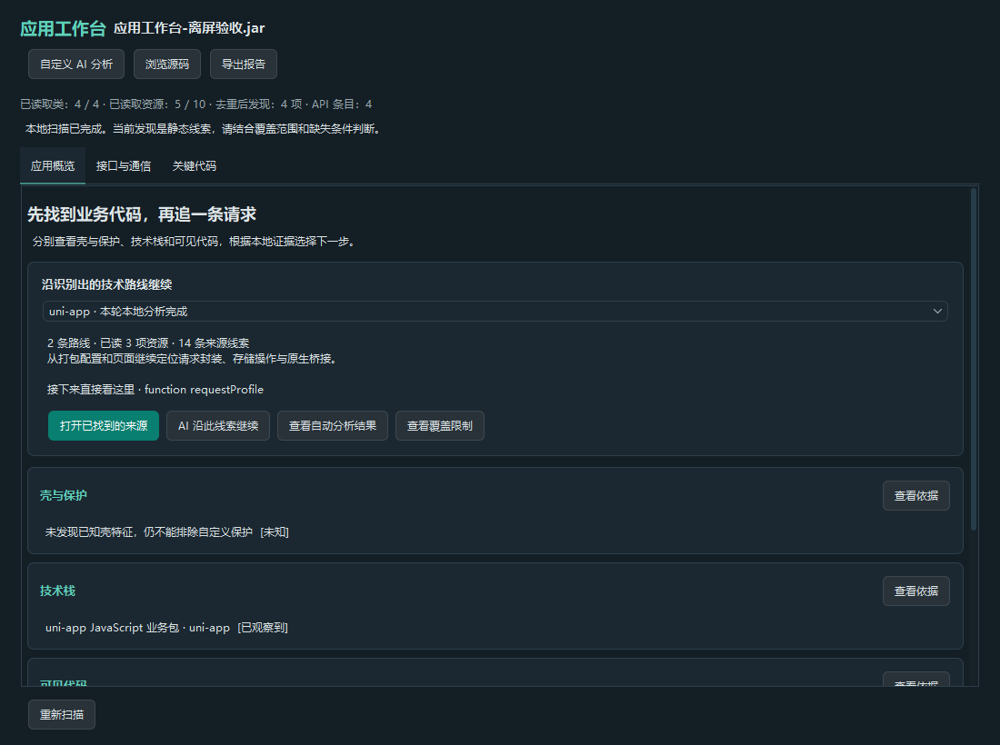
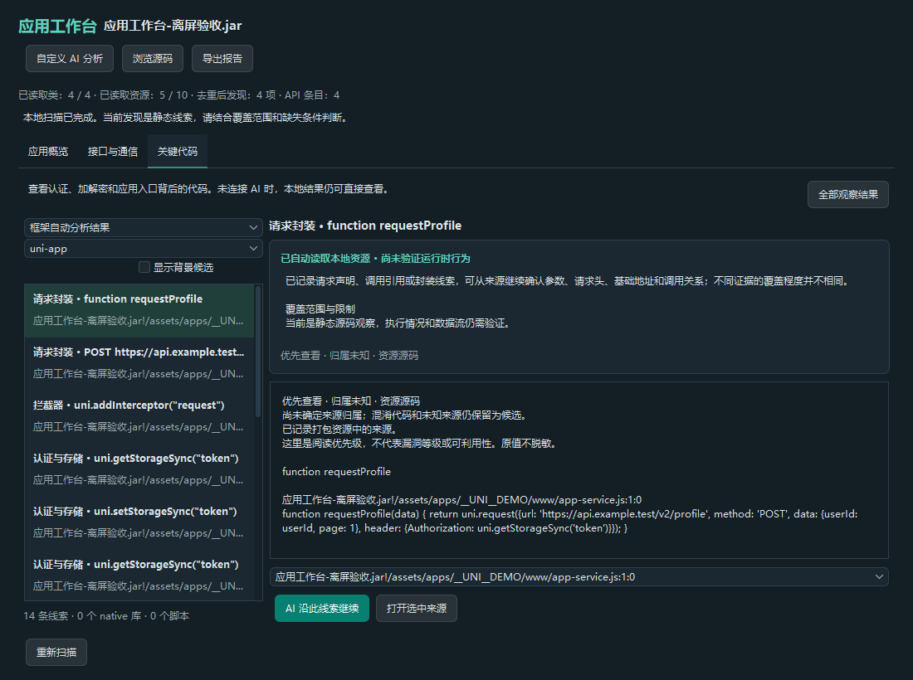
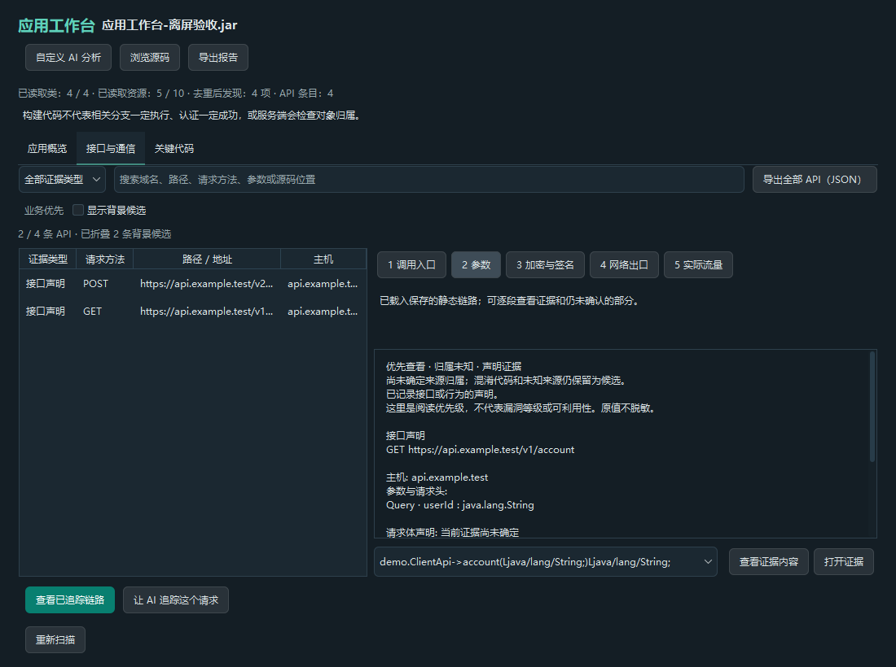
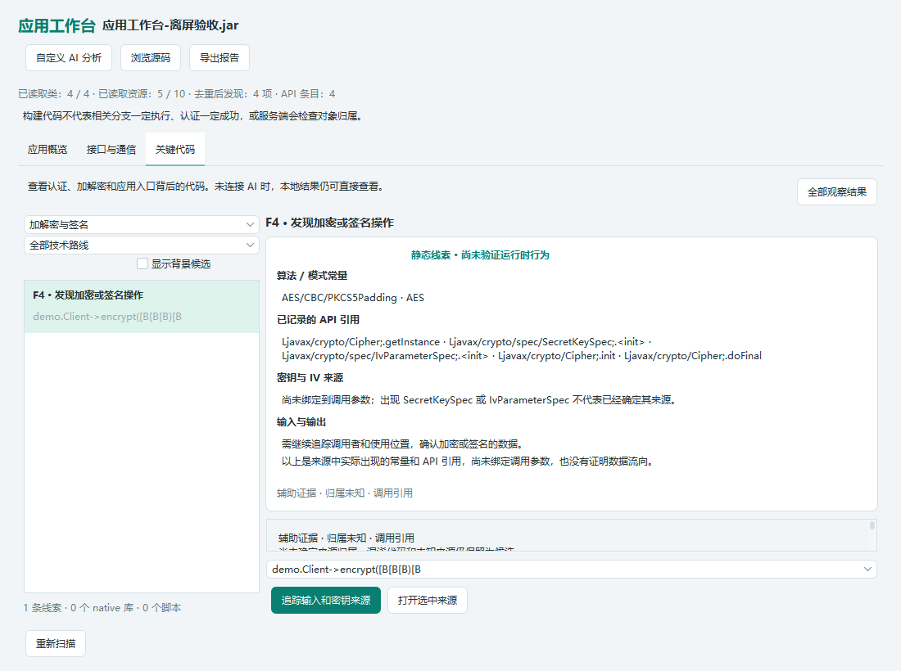

# APK 工作台（v2.1.0）

本页描述 v2.1.0 正式版的多技术栈工作台，见 [正式版说明](releases/v2.1.0.md)。基础扫描随程序运行，不需要额外安装 Python、Node、APKiD、Frida 或 Ghidra。AI 深入分析沿用已有模型连接，打开、恢复报告和重新扫描不自动请求模型。

## 从 APK 到一条请求

1. 拖入 APK，等待本地概览。壳与保护、技术栈、代码可见性分别展示，并附来源。带 `.apk.1` 的文件也按内容识别。程序按已发现的技术栈创建分析路线，继续检查对应配置、脚本或 native 产物；多个技术栈可以同时出现，各自显示覆盖状态和缺口。
2. 在「接口与通信」选择接口，立即查看已经提取的方法、地址和参数。默认「业务优先」折叠背景候选，勾选「显示背景候选」即可恢复；从其他页面直接定位某个背景接口时也会自动展开。点击追踪通信链路后，可切换调用入口、参数、加密签名、网络出口和实际流量。已有链路随项目保存，重复查看直接复用。
3. 在「关键代码」查看加密、认证、敏感配置、入口、JavaScript 和 native 库。框架自动分析结果优先展示，也归入请求、认证、配置、入口、JS 和 native 类别。来源按钮定位具体源码或资源；选择具体线索后可让 AI 沿该线索继续追踪。
4. AI 分析作为独立详情展开，保留计划、回答、证据和继续操作；随时返回三页工作台查看本地结果。「继续 AI 分析」可回到已有记录。
5. 保存 `.jadx` 项目保留分析；Markdown 报告包含概览和 native 盘点。API JSON 仍包含接口、调用关系与已保存的流量证据。

## 多技术栈自动分析路线

识别技术栈后，无需先填写任务或让 AI 猜测该读什么。当前路线按实际可读产物分工，不能把“识别到框架”解释成“业务代码全部恢复”。

| 路线 | 当前自动检查 | 覆盖边界 |
| --- | --- | --- |
| uni-app | 配置、页面与路由、可读业务脚本、发包调用或封装、认证存储、拦截器、native 桥接 | 动态拼接、跨文件数据流及未打包进 APK 的代码可能缺失 |
| React Native | 可读 JS bundle 中的请求、存储与桥接线索；识别 Hermes 产物 | Hermes 字节码只保留识别依据与解码缺口，不当作 JS 源码读取 |
| Cordova / WebView | 打包的 HTML、JS、配置及桥接线索 | 远端加载页面、运行时导航和桥接实参未完整恢复 |
| Flutter | 已打包的资源配置与相关 ELF 证据 | Dart AOT 未反编译；二进制资源与受限读取分别标明 |
| Android / Java / Kotlin | 已有本地接口、组件入口、密码学调用和桥接线索 | 复用 JADX 与受限静态追踪，不等于完整数据流分析 |
| Unity | 引擎及 managed / IL2CPP 产物线索、相关 native 盘点 | 未接入 C# 恢复或 IL2CPP 映射解码器 |

每条路线保留各类别的覆盖状态；界面显示路线状态、已读资源、发现数量与缺口。大文件、动态值和读取预算等限制随结果保留。框架运行时和 SDK 资源不会被当作业务源码恢复的证明。

概览中的下一步指向已经找到的具体来源，优先请求封装与拦截入口。点击「打开已找到的来源」可直接定位；「查看自动分析结果」进入关键代码页对应结果。点击「AI 沿此线索继续」后，模型从这条源码及其具体追踪方向继续分析，例如查调用者、请求头、存储值的读取位置或桥接目标。

自动路线读取本地资源并整理已有静态证据，不执行脚本、不请求模型。静态声明、命名与同一片段中的调用不等于已证明运行时行为或完整数据流。只看到 DCloud SDK 时也不会直接把整个应用判定为 uni-app。

本地结果、来源和导出保留实际原值。显式启动 AI 分析时，会将本次所选来源原文及后续读取的相关证据发送到已配置模型；界面的 AI 操作提示会说明这一点。

下图由应用组件离屏渲染，使用本地合成的 Java、uni-app 和 ELF 样本；不是实际目标的分析结论。

截图展示此前的 uni-app 工作流；新增多路线和分层筛选以当前界面为准。

## 本地能力与范围

| 能力 | 当前实现 | 尚不能证明的内容 |
| --- | --- | --- |
| 保护特征 | 受限扫描归档条目与已加载类名，展示已知加载器/库名线索和来源 | 单个名称不证明使用某壳；未命中不等于无保护；不能自动脱壳 |
| 技术栈 | 联合框架运行时、资源布局和类特征，识别 Flutter、uni-app / DCloud、React Native、Cordova / WebView、Unity 等产物 | SDK 可被嵌入，多个技术栈可共存；DEX 数量不等于业务代码完整 |
| Java API | 复用 Retrofit 声明、OkHttp / URLConnection 构造线索、受限客户端与调用者追踪 | 动态分发、反射、native 和任意跨方法数据流未完整解析 |
| JS 请求 | uni.request、fetch、axios 的直接调用，字面量拼接与有依据的同作用域常量；保留实际参数值、文件、行号与偏移 | 不执行 JS、不猜测跨文件变量、别名或自定义封装的数据流；Hermes 字节码不当作普通 JS 解析 |
| 框架自动路线 | 按技术栈检查对应资源；保留各路线的原文、来源、覆盖状态和具体 AI 追踪方向 | 不执行脚本，不把静态出现当作数据流已恢复；Hermes、Dart AOT、IL2CPP 等解码能力未集成 |
| 阅读优先级 | 按来源归属线索与证据类型分层；API 默认折叠背景候选，支持恢复和查看原因 | 包名或路径仅是归属线索；分层不代表风险等级、可达性或已验证漏洞 |
| 加密摘要 | 实际加密/摘要 API 调用及同方法算法字面量候选；关联当前接口已经追踪到的方法 | 同方法出现不等于实参绑定；密钥、IV、输入输出与用途需进一步取证 |
| Native | ELF32/64、大小端、架构、受限导入/导出符号、静态 JNI 导出 | 无反汇编、伪代码或动态 RegisterNatives 绑定；库名不证明业务用途 |
| 实际流量 | 复用 Burp 联动与显式读取、匹配、保存、转交 Repeater | 静态地址相关不证明该方法执行过或存在漏洞；实际 Burp 完整联调仍见单独说明 |

扫描有时间、条目、资源、库和符号上限。大 JS/HTML 只读取前缀，并标明范围缺口；受限或损坏的 ELF 保留文件盘点和限制原因。结果使用静态观察、疑似、未知等状态，不能将“文件存在”解释为“代码恢复成功”。

重新扫描后，历史 AI 记录仍可查看。只有输入、分析引擎和所选来源身份都一致时，才能继续旧任务；旧格式缺少来源身份的记录只保留阅读，避免编号变化造成证据对应错误。多 APK 存在同名资源时，来源定位保留所属归档；无法唯一对应时显示已保存证据。

Agent 的 `read_resource` 按当前项目资源标识读取 JS、JSON、HTML 等文本，每页最多 6,000 字符，并返回可继续读取的偏移；分页仍受资源读取前缀上限约束，不代表能读取任意大的完整文件。只读已加载项目内的资源，不执行脚本。旧版已经抹掉的值无法从历史记录中恢复，规则升级后会重新扫描原始输入。

### 框架规则的一手参考

| 官方资料 | 用于理解的产物或接口 | 当前边界 |
| --- | --- | --- |
| DCloud：[网络请求](https://uniapp.dcloud.net.cn/api/request/request.html)、[页面配置](https://uniapp.dcloud.net.cn/collocation/pages.html)、[拦截器](https://en.uniapp.dcloud.io/api/interceptor)、[原生插件](https://uniapp.dcloud.net.cn/plugin/native-plugin.html) | 请求、页面配置、拦截器与原生插件入口 | 识别静态配置和调用；跨文件与运行时数据流未完整恢复 |
| [Hermes 字节码格式定义](https://github.com/facebook/hermes/blob/main/include/hermes/BCGen/HBC/BytecodeFileFormat.h) | HBC 文件头与格式标记 | 格式识别不等于字节码函数恢复；未集成 Hermes 解码器 |
| [React Native 网络请求文档](https://archive.reactnative.dev/docs/network) | 可读 bundle 中的 Fetch 等网络调用 | 不执行 JavaScript；HBC 不按明文 bundle 处理 |
| [Cordova config.xml 参考](https://cordova.apache.org/docs/en/latest/config_ref/) | `content src`、`feature`、`android-package` 等配置声明 | 配置能给出入口或桥接候选，不能证明真实调用链 |
| [Flutter 平台通道](https://docs.flutter.dev/platform-integration/platform-channels) | MethodChannel、EventChannel 等跨语言边界 | 当前保留可读资源、Java 侧调用和 ELF 证据，未恢复 Dart AOT |
| [Unity Android 符号说明](https://docs.unity.com/en-us/engine/6000.7/manual/platform-specific/android/developing/testing-and-debugging/symbols) | native 符号与 IL2CPP 相关产物 | 当前是 managed / IL2CPP / ELF 盘点，未恢复 C# 或解码 IL2CPP 映射 |

## 降噪如何影响结果

当前分层同时考虑来源归属线索和信号类型：接口声明、调用引用、资源源码、字面量、文件盘点分别表达。应用命名空间、常见库命名空间、框架运行时和未知来源也是不同维度；仅命中 SDK 前缀不会被描述为已确认库归属或版本。

API 清单默认突出有请求依据的条目，背景候选包括没有请求调用依据的裸 URL，以及按现有来源线索归入库或运行时的条目。未知归属的接口声明和请求构造仍显示。详情说明分层原因；数量栏显示当前筛选范围内折叠了多少条。需要查看完整清单时，勾选「显示背景候选」并清空文字及来源筛选即可。

折叠只是显示选择：不修改 URL、token、参数或原始证据，不删除报告记录，也不改变全部 API 导出的范围。当前仍按既有身份规则进行去重并保存来源；按请求结构组织完整变体树、库版本指纹匹配、全程序数据流与自动运行时验证属于后续方向。

### 资源很多时，仍为字节码线索保留空间

资源先被扫描时，大量字面量和运行时文件可能先占用一般结果预算。当前对应用命名空间及归属未知的字节码线索提供额外、有上限的保留空间；API 记录也按来源类型保留相应额度。已识别的库或框架运行时命名空间不会使用这部分空间。字节码扫描同时优先读取应用及未知来源，减少业务代码排在常见 SDK 后面的情况。

保留空间也可能耗尽，不保证业务结果完整。达到上限后，报告保留按类别统计的省略匹配次数和覆盖缺口；该计数是没有收录的匹配次数，不是独立漏洞数，也不能直接视为唯一来源数。仅折叠的背景候选仍在报告中；因读取或收录预算没有保存的内容，需要后续定向读取，不能从“显示全部”恢复。

### 代表片段与来源索引分别保存

同一发现最多保留 5 份带原文的源码片段预览，另存最多 128 条精简来源索引。预览优先保留有代码依据、便于继续阅读的来源；每份片段本身仍有长度上限，不是完整文件。索引记录节点或资源位置、指纹和截断状态，随发现保存，不为每个来源重复存放原文。

超过索引上限的来源出现次数单独记录，不能理解为唯一遗漏位置数。这一机制适用于分析发现，不表示每个 API 已保存 128 份请求原文，也不表示界面逐项展示全部索引。URL 查询值、用户名密码、请求头和可静态确定的参数值仍按实际原值保留；大小限制和控制字符处理继续生效。

### AI 沿当前线索继续，缺哪一环再找哪一环

从具体线索启动 AI 时，初始上下文优先限定到所选线索的来源，以及本次调查已经追踪到的引用；不会因同属“请求”或“加密”类别，就把其他无关候选全部带入。当前的关联依据包括同一 Java 声明类、同一归档资源和已观察到的引用，因此仍不是完整程序切片、可达性证明或污点数据流。

背景候选仍可通过定向 `search_artifacts`、符号检查、引用追踪或 `read_resource` 找到。需要扩展时，Agent 应先在公开计划中指出缺失的具体环节，再围绕该环节查找。工具返回同样受读取和数量预算约束；没有找到结果不等于不存在。显式选择来源后，相关原始证据可发送到用户已配置的模型，人工评审备注不会自动加入模型上下文。

## 开源与专利研究记录

本轮参考以下一手资料，将来源、证据类型和阅读优先级分开。下表中的设计启示不表示相关引擎或全部算法已经集成。

| 来源 | 已核实的技术要点 | 借鉴与边界 |
| --- | --- | --- |
| [LibScout](https://github.com/reddr/libscout) | 使用原始 JAR/AAR 生成库特征，进行相似度匹配及库 API 使用分析 | 归属判断应允许候选、未知和冲突。本项目当前是轻量来源线索，未集成 LibScout 引擎或完整库版本特征库 |
| [FlowDroid](https://github.com/secure-software-engineering/FlowDroid) | 按来源与敏感操作模型分析 Android/Java 数据流；提供调用图、数据流和结果收集的预算与超时 | 定向追踪须展示缺口；未找到路径不等于安全。未集成 FlowDroid，当前调用关系不能声称是完整污点传播 |
| [CodeQL 查询元数据](https://codeql.github.com/docs/writing-codeql-queries/metadata-for-codeql-queries/) | 查询精度、严重程度、单点结果与路径结果分别建模 | 当前把阅读优先级与风险结论分开；规则打分不冒充统计准确率或模型置信概率 |
| [MobSF 抑制实现](https://github.com/MobSF/Mobile-Security-Framework-MobSF/blob/master/mobsf/StaticAnalyzer/views/common/suppression.py) | 支持规则/文件抑制、查询、撤销与计数 | 借鉴可恢复的显示选择；当前分层折叠不等于人工认定误报，也未提供按相似代码自动传播人工结论 |
| [TruffleHog](https://github.com/trufflesecurity/trufflehog) | 区分已验证、未验证、验证未知等状态；部分验证需要外部 API | 原始密钥候选与有效凭据是两回事。本地扫描不自动请求外部服务验证发现的值，未集成 TruffleHog 引擎 |
| [CN110378118A：高效准确的安卓应用第三方库检测方法](https://patents.google.com/patent/CN110378118A/zh) | 2019-10-25 公开；结合模块、类签名、相似度和候选过滤识别库 | 启示是记录归属依据与冲突，而不是仅凭包名断言。当前未复刻其加权公式与候选过滤流程 |
| [US20170195358A1：System, method and apparatus for fully precise hybrid security verification of mobile applications](https://patents.google.com/patent/US20170195358A1/en) | 2017-07-06 公开；静态候选映射到 UI 入口，再进行定向动态验证 | 将入口、请求和缺失的运行证据串联；当前仅已有静态追踪和显式流量关联，不承诺完全精确或自动证明漏洞 |
| [US20230169177A1：Source code clustering for automatically identifying false positives generated through static application security testing](https://patents.google.com/patent/US20230169177A1/en) | 2023-06-01 公开；以结构/数据流指纹聚类并利用已复核结果判断相似代码 | 当前采用稳定来源身份保存记录；不会仅因代码相似就自动继承“误报”或“已证实”结论 |

专利资料仅作技术研究，不提供法律判断、实施许可结论或精度保证，也不将专利中的效果主张当作本项目验证结果。后续可在独立需求和测试约束下完善库归属、参数切片、请求变体和运行证据关联。

## MCP

启用现有的项目共享后，外部调用者可以使用 `get_apk_profile`，获得本地技术栈、保护特征、代码分布及分页 native 符号样本。`offset` 控制库列表分页，`limit` 默认 6、最大 20；每组符号最多返回 20 条并标明截断。切换项目或撤销共享后不能继续读取旧项目。此工具不安装依赖、不连接设备、不执行被分析代码。

## 后续工具联动

APKiD 特征库、Frida 设备采集、Ghidra 深度反编译是后续适配方向，不是本轮已实现的按钮能力。接入时应由程序发现和准备兼容组件；脱壳流程还需要检查设备条件、关联新增 DEX 与原 APK，并验证业务代码覆盖是否改善。已有静态结果应始终可用。
