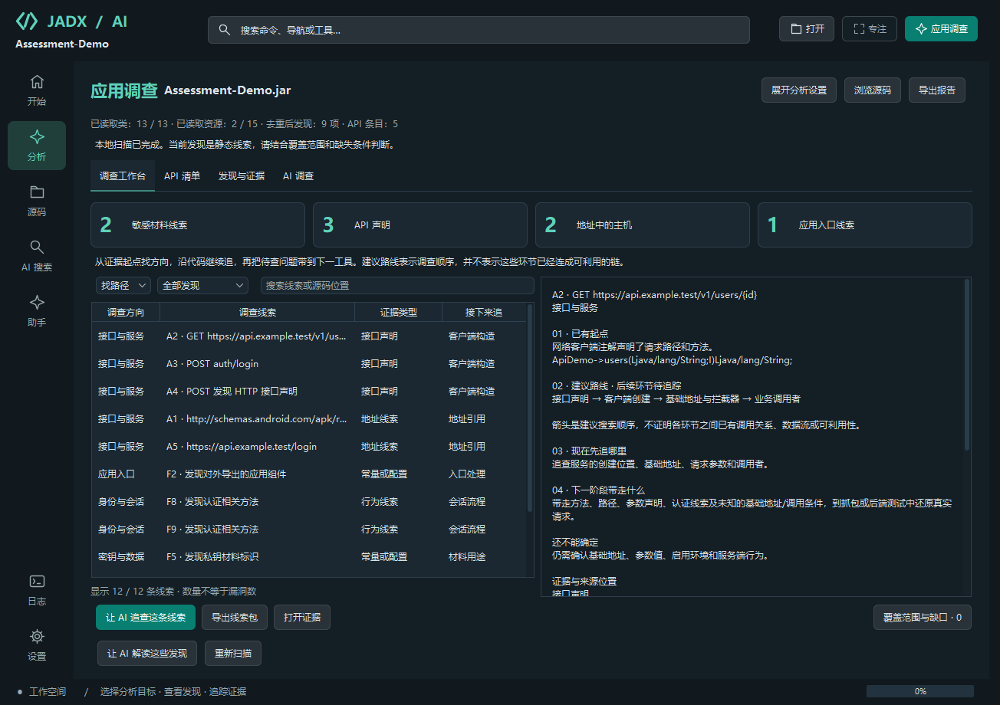
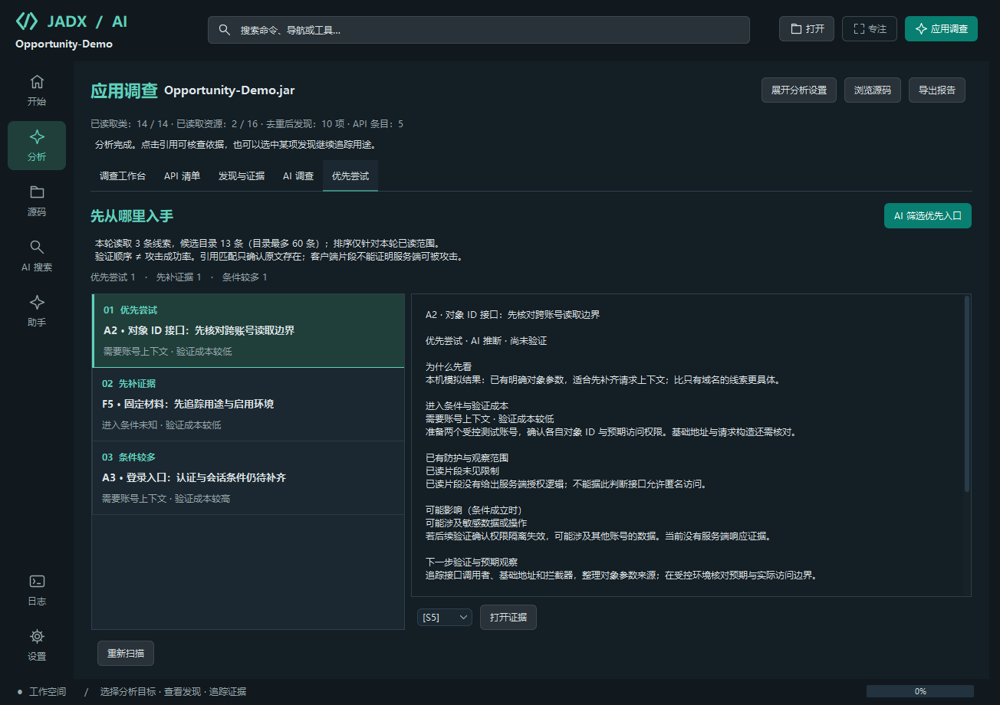

# 从 APK 线索寻找渗透方向

本流程从 v2.0.0-beta.4 开始随发布包提供。核对日期：2026-10-12。

## 先寻找路径，需要时再核查

打开 APK 后进入“应用调查”，默认目标为“寻找渗透路径”。点击开始后，本机先收集字节码和资源中的线索；无需配置模型即可使用。启用 AI 时，再由审计连接选择证据、读取相关代码并解释调查方向。用户可以只获取后续渗透所需的信息，无需在 JADX 内完成漏洞判定、评级或整份评估。

完成本地发现后自动收起分析设置，把空间留给调查列表；“展开分析设置”可以修改目标、问题和模型选项。工作区按调查顺序排列：

| 页面 | 用途 |
| --- | --- |
| 调查工作台 | 默认“找路径”，按接口与服务、应用入口、身份与会话、密钥与数据、执行路径、环境与配置组织起点；“做核查”保留优先级和人工记录 |
| API 清单 | 梳理声明、地址和请求构造入口，查看方法、路径、参数、认证线索和来源 |
| 发现与证据 | 按原始规则类型查看本地发现，跳转源码，当前扫描会话可主动查看原始值 |
| AI 调查 | 查看最近一次 AI 调查及引用；根据目标解释调查路线或潜在问题 |
| 优先尝试 | AI 比较本轮已读候选的进入条件、防护、成本和可能影响，说明为什么先看以及下一步 |

统计数字表示已提取到的线索，既不是漏洞数，也不代表完整攻击面。“地址中的主机”可能包括 SDK、文档、测试环境和 XML 命名空间。覆盖范围与缺口可随时打开；没有发现不能证明没有问题。

[浅色主题](images/exploration-light.png)。以上界面由实际 Swing 组件渲染，使用专门编译的演示包；AI 交互使用本机模拟服务，不用于证明模型推理质量。

## 从当前证据走到下一阶段

“找路径”显示调查方向、线索起点、依据类型和下一项要追踪的对象。右侧列出已有起点、建议路线、当前应读的代码和下一阶段要携带的材料。例如，接口声明的建议调查顺序为“接口声明 → 客户端创建 → 基础地址与拦截器 → 业务调用者”；导出组件则从入口处理、外部输入和敏感操作继续查。

**当前路线指南按线索类型生成，箭头表示搜索顺序，不是已经还原出的调用图或可利用攻击链。** AI 会进一步读取定义与调用者，用证据引用区分源码支持的关联、待追踪环节和运行时问题；共同出现的域名、凭据或组件不会因此被当成有关联。

“导出线索包”将当前选中项的静态信息、来源位置、建议路线、未知条件和下一阶段材料保存为 Markdown。接口条目保留方法、路径、参数及认证线索；不与其他条目的域名或凭据自动拼接。可以把它带到抓包、设备或后端测试环境继续调查，导出本身不执行测试，也不会生成可运行请求。人工笔记和其他条目的 AI 回答不会混入这个单条线索包。

在“找路径”和“做核查”之间切换会同步整体 AI 调查目标；不会要求先填评级或核查记录，也不会删除已有记录。原有“核查潜在问题”目标可直接打开核查视图。

## 先尝试哪些入口

完成扫描后点击 **“AI 筛选优先入口”**，AI 从候选目录选择最多 6 条线索，读取相关定义与调用者，再生成“优先尝试”卡片。默认“寻找渗透路径”和“核查潜在问题”目标都使用这一结构；针对单条线索的追查只评价当前线索，不宣称对整个 APK 排序。卡片包含：

- **为什么先看**：和本轮其他候选相比，已有依据与验证成本有什么优势。
- **进入条件**：账号上下文、设备条件、参数来源和其他前提。
- **防护与影响**：已读范围内有哪些检查，条件成立时可能影响什么。
- **下一步**：要补读或验证什么、预期观察是什么、哪些反证会否定推测。
- **引用原文**：选择引用可跳回源码或证据快照。

排序分为“优先尝试”“先补证据”“条件较多”。排序由模型提出，本机做保守限制：只有模型建议优先、进入条件和影响明确、验证成本较低、防护情况不是未知或已观察到防护，且引用了本轮实际读取的完整行为代码，才保留“优先尝试”。纯地址线索、抽象签名、未知条件、代码截断或已有防护的候选会被限制为“先补证据”；模型主动延后的候选保留“条件较多”。这些枚举和说明仍是 **AI 推断**，不是经过设备或服务端验证的事实。

每张卡只能引用本轮为它收集的来源。陌生线索 ID、跨线索借用证据、原文不匹配、空引用或非法字段会使卡片被排除。共享定义与调用者通过本机来源映射关联，不靠模型或标题猜测。引用匹配只证明文字确实存在，不证明模型对进入条件、数据流、防护或影响的解释正确。客户端未要求登录、片段中没有鉴权代码，都不能证明服务端允许匿名访问。

界面展示本轮选择数量、目录数量与调查边界；目录最多 60 条，仍可能遗漏未选择、未解密或未提取出的入口。没有有效卡片时保留 AI 回答与明确提示，不从关键词自动生成“容易攻击”的结论；格式错误或响应截断时也可查看原文。默认输出为少量候选，模型输出长度不足时可提高连接的输出上限，或选择一条线索深入调查。

卡片随项目保存，完整 Markdown 导出包含排序依据、限制、证据和原始模型响应。新一轮 AI 调查替换上次卡片；本地重新扫描会清除旧 AI 结果，取消 AI 请求保留此前结果。切换或卸载项目会清空页面，迟到的请求回调不会恢复旧结果。人工核查记录独立保留。

[浅色主题](images/opportunity-light.png)。截图来自演示接口及调用者；使用本机模拟模型验证排序、引用和交互，不代表真实模型的识别准确率。

## 让线索变成核查任务

切换到“做核查”后，队列对私钥材料、固定凭据、令牌与调试配置优先排序；API 声明、组件、认证、加密、动态执行和 WebView 等作为后续调查入口；普通网址和公开客户端标识作为资产线索。

这是**核查优先级**，不是自动评定的漏洞等级。右侧逐项展示：实际观察、条件成立时的潜在影响、未确认的条件、下一步和证据来源。来源类型明确区分常量或配置、行为线索、接口声明、地址线索及请求构造调用。

例如：

- 找到私钥格式标识后，先查材料是否完整、谁读取、实际用途及适用环境，再评估暴露影响。
- 找到带对象 ID 的接口声明后，先梳理基础地址、认证与调用关系；越权核查还需要测试环境中的账号角色、对象归属、预期权限边界与实际响应。
- 找到导出组件后，继续看组件权限、入口输入处理和内部敏感操作，不能把导出本身视为漏洞。

“让 AI 追查这条线索”会读取该证据及有限深度的定义/调用者。整体渗透目标的最多 60 项候选按证据类型交错选取，防止大量同类常量挤掉 API 和组件线索。最多选择 6 项，保留既有 16 份证据、36,000 字符预算；因此该流程仍是有范围限制的调查。

## 人工验证与报告

需要记录验证结果时，在“做核查”中选中线索并点击“记录核查结果”，可以记录：

| 人工状态 | 含义 |
| --- | --- |
| 未核查 | 仅有静态发现 |
| 核查中 | 正在补充证据 |
| 待运行验证 | 仍需要设备、测试环境或服务端行为证据 |
| 人工已复现 | 用户记录了复现情况；保存时必须说明依据 |
| 人工已排除 | 用户记录了排除原因；保存时必须说明依据 |

影响评级默认为“未评级”，由用户单独填写。状态、评级与笔记均不会被 AI 回答覆盖；“人工已复现”不表示工具执行过复现，也没有自动核验用户填写的结论。建议在记录中说明测试环境、步骤、实际与预期行为，以及日志或截图的证据位置。

核查记录随 `.jadx` 项目保存到磁盘。仅同一输入文件指纹、仍存在且证据身份一致的条目会在重扫时继承记录，不依赖易变的 F1/A1 序号；APK 内容变化时不会继承旧结论。旧报告没有核查记录时保持“未核查”。扫描尚未完成时可以查看证据，AI 深入调查与人工核查记录在本地发现完成后启用；重扫取消后的部分结果不会替代上次保存的完整评估。

Markdown 报告同时包含核查队列、人工状态与评级、记录时间、笔记、API 清单、来源证据及最近一次 AI 回答，保留覆盖范围和未知条件。API 单独导出 JSON 仍只包含静态清单。

**数据边界：** 自动发现的敏感值沿用脱敏规则。人工备注按原文保存在本地项目，不自动加入 AI 请求；导出时应用有限的模式脱敏，并非任意个人信息识别。请在笔记中记录证据位置，避免粘贴原始凭据。这一例外不改变扫描原始值只存在于当前内存会话的规则。

## 研究依据与当前边界

本设计参考 [OWASP MASVS](https://mas.owasp.org/MASVS/) 对认证、网络、存储、密码学和平台交互的分类，以及 [MASTG 网络信息收集](https://mas.owasp.org/MASTG/techniques/android/MASTG-TECH-0022/) 的调查思路。客户端接口结构用于建立验证任务；服务端对象授权缺陷需要相应行为证据，参见 [OWASP API1 对象级授权](https://api-security.owasp.org/editions/2023/en/0xa1-broken-object-level-authorization/)。这些资料是设计依据，当前功能不构成完整 MASVS 合规检查。

当前实现不会执行 APK、主动请求目标接口、验证凭据或自动完成渗透测试。基础地址与拦截器关联、网络安全配置的域名规则、完整组件权限链、运行时流量与服务端验证仍是后续工作；详细提取范围见 [API 清单说明](API_INVENTORY.md)。
