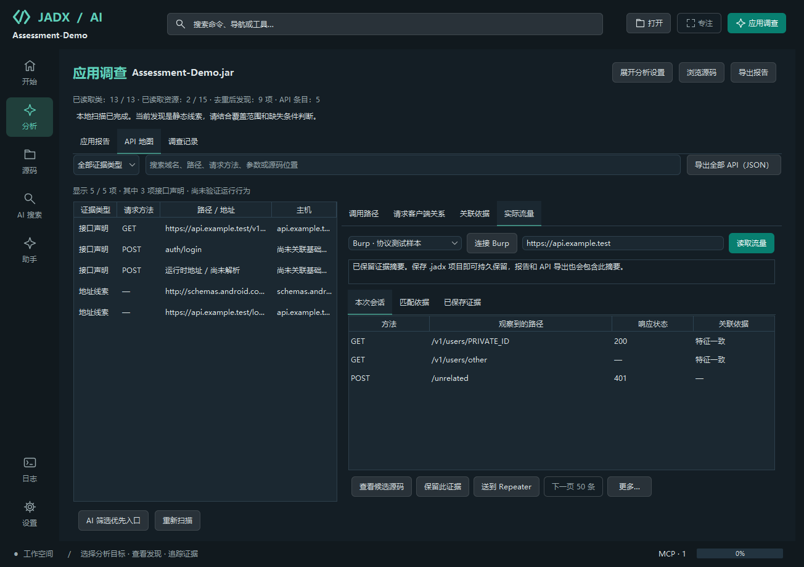
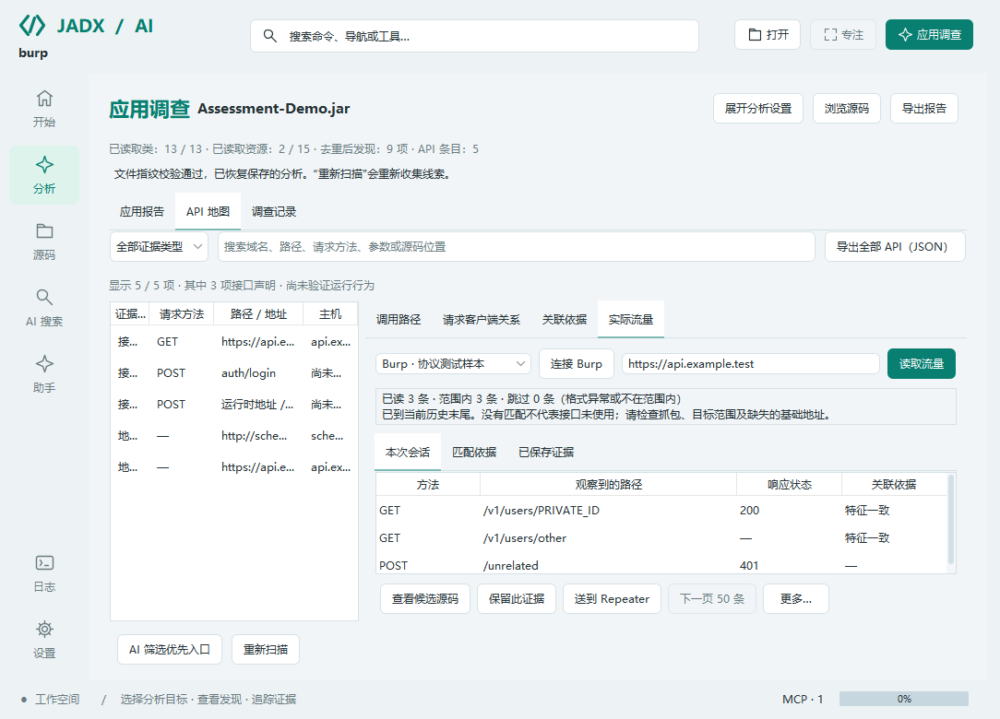
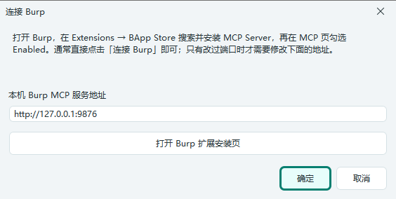

# Burp 联动：从接口声明到实际流量

> 主分支开发功能，尚未包含在已发布的 v2.0.0 包中。基础 APK 报告仍可独立使用；本页功能需要运行 Burp Suite 与 PortSwigger 官方 MCP 扩展。

入口：**应用调查 → API 地图 → 实际流量**。

以下截图使用协议测试样本，展示开发版界面，不代表已经完成真实 Burp 抓包联调。

浅色主题与小窗口布局

## 第一版的使用顺序

1. **打开 APK，看本地报告。** 在 API 地图选择要调查的接口。相对路径可先点击「一键梳理接口」查找客户端基础地址。
2. **连接 Burp。** 在 Burp 的 **Extensions → BApp Store** 搜索并安装 [MCP Server](https://portswigger.net/bappstore/9952290f04ed4f628e624d0aa9dccebc)，在 MCP 页勾选 **Enabled**。回到本工具点击「连接 Burp」，自动使用默认本机地址 `http://127.0.0.1:9876`，连接成功后记住配置。
3. **确认目标地址。** 填写 `https://api.example.com` 或 `https://api.example.com:8443`，仅包含协议、主机和可选端口。明确的静态地址会作为建议填入；手动修改的地址会保留。切换接口时，尚未手动修改的建议会跟随接口变化。
4. **读取已捕获流量。** 每次读取 50 条，按需翻页，最多读取本次查询的前 500 条。读取不执行目标请求，也不请求模型。列表显示方法、实际路径、响应状态和与当前 API 的关联程度。
5. **核对依据。** 「匹配依据」解释关联条件；「查看候选源码」打开当前 API 的源码位置。「更多 → 查看原始报文」查看当前会话收到的请求和响应。
6. **保留证据或送到 Repeater。** 证据摘要随 `.jadx` 项目保存，也进入报告和 API JSON 导出。转交 Repeater 前会预览原始请求和选定目标；确认后只创建标签页，实际发送在 Burp 内操作。

JADX 内置直接连接所需的 HTTP+SSE 客户端，**无需导出代理 JAR、选择 Java、填写 JSON 参数或另装 Python / Node**。Windows 完整包使用随包 Java 21。Burp 与其官方扩展仍需安装并运行；点击连接后才访问该服务，程序启动时不会自动连接。

连不上时，页面直接提供扩展安装页和连接地址入口。改过 Burp 端口时使用「更多 → 连接地址」，地址只需设置一次；已有连接再次点击「连接 Burp」即可重连。原有 stdio 代理配置仍可使用，复杂配置保留在「更多 → MCP 设置」。专用引导仅接受本机 HTTP 地址。

手机代理、CA 信任、应用证书校验以及实际流量捕获仍需在测试环境中配置；连接成功不等于已经抓到 APK 的请求。

## 如何理解关联结果

| 显示 | 含义 |
| --- | --- |
| 特征一致 | HTTP 方法、主机和静态路径模式相符；不代表已观察到具体代码方法的执行 |
| 候选关系 | 路径可对应，但静态基础地址或 HTTP 方法缺失，需要继续核对 |
| 无关联标记 | 当前 API 没有受支持的对应关系；不会强行绑定到一个方法 |

匹配遵循已解析的客户端基础路径；`{id}` 等路径参数仅匹配单个路径段；同一段出现多个变量的歧义模板暂不关联。方法、已知主机、协议或端口冲突时不建立对应关系。多个接口可能描述相似请求，当前匹配不会消除这种歧义。运行时动态 URL、缺失路径的请求构造入口和被截断的静态声明保持未关联。

官方历史工具返回的请求文本通常只有 `Host`，不一定包含原始协议和目标端口。因此，**目标地址中的 HTTP/HTTPS 和端口是用户选择，不能当作抓包观察事实**。在有绝对请求地址或明确端口时会检查冲突。只有路径相似时，不能证明来自同一调用链。

读取使用官方 `get_proxy_http_history_regex`，先按主机文字查询，再本地核对实际请求的主机、已知协议和端口。命中响应正文中的主机名、格式异常或范围外的记录会被跳过并计数。Burp 历史变化可能影响基于偏移的翻页，当前结果不是稳定的全量快照；没有记录或没有匹配均不等于接口未使用。

## 哪些内容会保存

- **只在当前会话：** 收到的原始请求、响应和具体路径值。重新读取、变更目标或连接、重载和卸载项目时清除；不会写进 `.jadx`、API 导出或应用报告，也不会由该页面自动交给模型。
- **点击保留后保存：** 对应接口的稳定标识、选定目标、静态路径模式、请求方法、响应状态、查询字段名、请求头名称、本地读取时间、关联等级、截断标记和用于去重的报文摘要指纹。保留字段名称不意味着任意个人信息识别；分享前仍应核对主机、路径及字段名。
- **容量：** 每接口最多 20 条，每项目最多 200 条。同一接口、选定目标和相同报文重复保留会更新摘要，不增加条目。可在「已保存证据」中移除当前接口的记录。
- **项目恢复：** 原始报文不会恢复，因此恢复后不能直接重放已保存摘要。同一输入与引擎配置重新扫描时，仅保留仍能对应到相同 API 的摘要。
- **导出：** API JSON 使用 `schemaVersion: 4`，保留 `endpoints` 与 `clientRelations`，新增 `trafficEvidence`；每项带当前 `endpointId` 和证据摘要。应用 Markdown 报告另列流量证据。

源码助手中另行启用外部 MCP 后，沿用原有逐次调用确认与模型数据流。新连接默认使用 `burp-readonly` 工具范围，只向 AI 提供 HTTP 历史读取工具；本页的 Repeater 按钮独立执行明确选择的转交操作。

## 转交限制与错误处理

官方历史工具可能将大报文截断到有限长度。当前适配器接受连续 JSON 对象形式的历史结果，遇到拒绝或无法解析的结果会显示失败，不会将其伪装成空历史。

Repeater 转交仅支持收到的完整、小于等于 24,000 字符的 ASCII HTTP/1.x 请求，并检查正文长度与请求头。截断、HTTP/2、分块正文、二进制或非 ASCII 文本，以及长度不一致的快照不转交，应回到 Burp 使用原始请求。响应截断会显示提示，但在请求完整时不阻止转交。

工具参数使用服务实际公布的 schema，缺失工具、类型不兼容或出现未知必填字段时拒绝调用，不猜测新参数。结果异常时不会自动重试 Repeater，以免重复创建标签页；请先检查 Burp。取消请求可能关闭该连接，需要显式重连，已经完成的外部操作不会撤销。

## 实现与验证范围

适配接口依据 [PortSwigger MCP 源码快照](https://github.com/PortSwigger/mcp-server/tree/642e6fa31c63db3886a353fcd7ed62037e0ceed5)：历史序列化格式、分页参数、截断标记和 Repeater 工具参数。保留 GPL 项目为独立外部服务，没有将其实现复制或打包到本项目。

内置直连依据[官方扩展的 SSE 连接方式](https://github.com/PortSwigger/mcp-server)和 [MCP 2024-11-05 传输规范](https://modelcontextprotocol.io/specification/2024-11-05/basic/transports)。首次 SSE 握手最多等待 10 秒；之后的工具发现与请求各有 60 秒时限。消息端点必须与配置地址同源，不跟随重定向。

验证覆盖空连接配置下的一键直连、解析与异常数据、范围冲突、相对路径、占位符、持久化脱敏、证据上限、实际 Java stdio 子进程与 HTTP+SSE 流、分页、超时、取消和 Windows Swing 操作。协议样本使用模拟 Burp 服务，不发送真实目标请求；完整 Burp 扩展与手机抓包的实机联调尚未完成，不宣称所有 Burp 版本兼容。

后续优先根据真实使用反馈补充原始 HTTP 服务元数据、稳定历史索引与更完整的报文获取，再考虑将用户选定的流量摘要加入 AI 调查。首版不自动发请求、不自动扫描，也不把流量关联当作漏洞结论。
